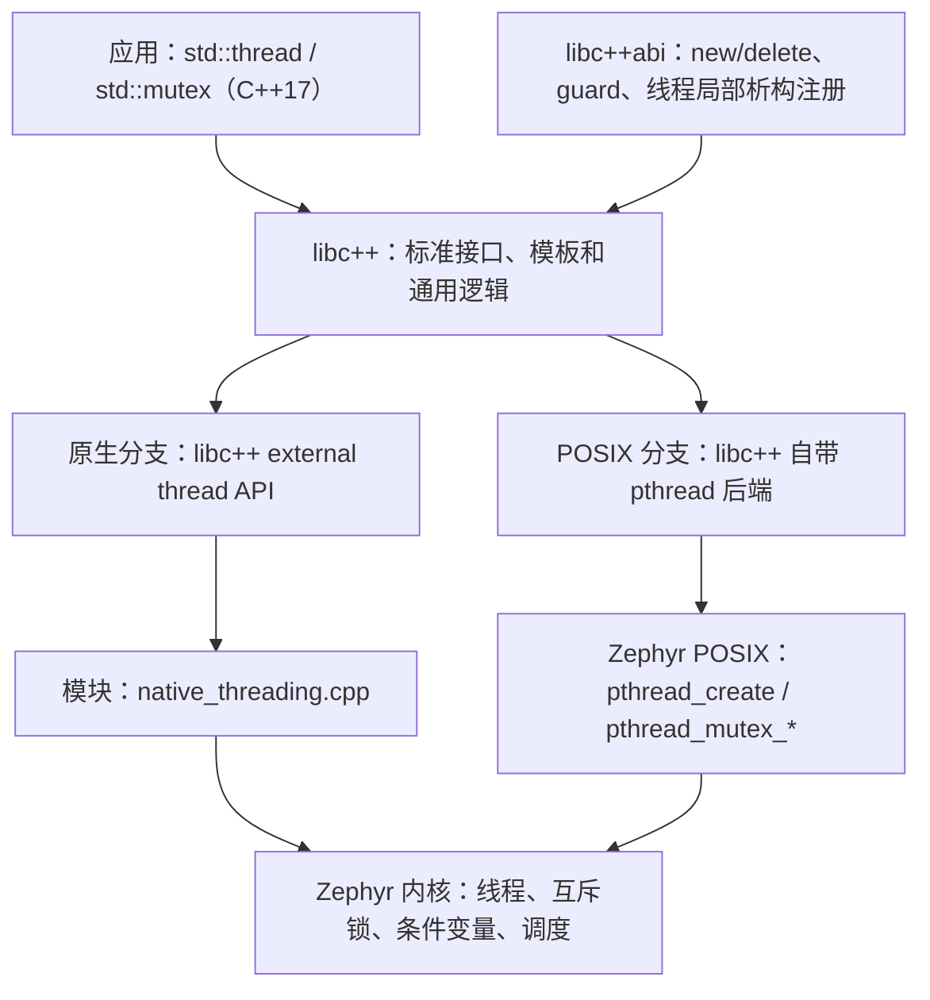

# Zephyr C++17 线程与同步外部模块

标准库源码和适配器放在独立仓库，通过 Zephyr 的
EXTERNAL_MODULE_LIBCPP 接口接入。编译应用时同时编译 libc++ / libc++abi，
不会替换 SDK，也不修改编译器安装目录。

本次范围：std::thread、mutex / recursive_mutex / timed_mutex、
condition_variable、call_once、shared_mutex、future / promise / async，
以及线程正常退出时的 C++ thread_local 析构。应用使用 C++17。
异常、RTTI、文件系统、iostream 不在这个配置的范围内。

原生分支现已加入真正的 userspace 路径：一个 C++ 应用域内共享运行库和堆，
线程保持用户态，内核对象通过校验过的系统调用操作。
设计、安全边界、实验命令及验收记录见[用户态线程与同步说明](docs/userspace.zh-CN.md)。
QEMU 回归通过不等于你们的硬件、修改版 LLVM 16 已完成产品验证。

## 两个分支

| 分支 | 标准库后端 | Zephyr 依赖 |
| --- | --- | --- |
| libcxx-native-module-threads | libc++ external thread API → 本模块适配器 | k_thread / k_mutex / k_condvar |
| libcxx-posix-module-threads | libc++ 原版 pthread 后端 → Zephyr POSIX | POSIX_THREADS 和少量 C++ TLS 胶水 |

两个分支都把标准库放在外部模块。这里比较的是线程后端，模块存放位置相同。
POSIX 方案使用的是 libc++ 的 pthread 后端；gthr 是 libstdc++ 的接口，
本次不混入另一套标准库。

## 从程序到操作系统，如何串起来

编译器理解 C++ 语法，把程序变成机器指令；std::thread 的实现则来自标准库。
标准库并不知道每个 RTOS 如何创建线程，因此需要一个操作系统接口。



例如创建 std::thread 时，两条路径最终都调用 Zephyr 内核创建线程。
mutex 也一样：原生分支在 supervisor 配置下把内核互斥锁放在 C++ 对象里；
userspace 配置下则保存 64 位句柄，真实对象留在受保护的服务中；
POSIX 分支的 C++ 对象保存 pthread 句柄，再通过 Zephyr 的 POSIX 对象池找内核锁。

POSIX 动态线程池还要求启用 THREAD_MONITOR，原生分支没有这个强制要求；
这属于各自实现所需的系统开销，也计入测量。

因此“多一层”不能直接换算成性能或大小。POSIX 对象句柄更小，
但要预留全局对象池；原生对象更大，调用路径更短。必须把两部分一起测量。

## 构建时发生什么

1. Zephyr 读取 zephyr/module.yml，再读取模块 Kconfig 和 CMakeLists。
2. 应用选择 EXTERNAL_MODULE_LIBCPP，让 Zephyr 不自动链接 SDK 自带的 C++ 库。
3. 模块取得固定版本的 libc++ 和 libc++abi 源码，生成 __config_site，选择线程后端。
4. 应用和标准库使用同一个编译器、目标架构、C 库、TLS 和 Zephyr 配置编译。
   应用保持 C++17；LLVM 的运行库源码用 C++23 模式构建。
5. 链接器按实际引用保留代码，未用到的源码函数通常会被回收。

我们固定 libc++ / libc++abi 18.1.8，源码下载使用 SHA256 校验。
[官方支持表](https://releases.llvm.org/18.1.8/projects/libcxx/docs/)列出 Clang 16 和 GCC 13。
它适合需要保留 Clang 16 的场景；本次实际使用的编译器版本和验证范围见比较报告。
本模块最低接受 GCC 13 或 Clang 16。能通过版本检查不等于你们修改过的
LLVM 16 已验证，目标 ABI、TLS 和编译选项仍需用实际工具链确认。

可设置 LIBCXX_SOURCE_DIR 和 LIBCXXABI_SOURCE_DIR 使用已解压源码。
18.1.8 的头文件版本宏为 180100，不能仅凭这个宏区分 18.1 的补丁版本；
离线源码目录的准确来源由调用者负责。

## 设计取舍与难点

- **资源有上限。** 示例为最多 8 个标准线程，每线程 4096 字节栈，
  TLS key 容量 8；不是 Linux 式无限创建。创建并回收的次数可以超过 8。
- **正常退出必须完整。** 线程函数返回后，要先执行语言 thread_local 析构，
  再让 notify_all_at_thread_exit 和 future 的退出就绪通知生效，
  最后才能释放栈、回收线程槽。只把 create/join 接上并不足够。
- **并发回收需要等线程真正结束。** 退出标记与内核停止执行之间存在窗口。
  POSIX 分支附带针对本次 upstream 基线的私有实现修复；
  原生分支在适配器内管理这个顺序。
- **配置影响 ABI。** 原生 mutex 直接包含 Zephyr 内核对象。
  用户态配置则使用句柄，布局不同。
  本模块按每个应用的配置从源码构建，不能把任意配置生成的静态库混用。
- **主线程不是 pthread。** POSIX 胶水为原生调用者提供不同的 C++ thread::id，
  这不表示原生线程已完整接管为 POSIX 线程。pthread TSS 和完整采用逻辑没有实现。
- **当前运行条件。** 静态链接，支持 supervisor 或单一 C++ 应用域的 userspace。
  标准线程正常返回时自动清理；原生根线程在自动对象析构后调用
  cpp_runtime_thread_cleanup()。强制 abort、fault、动态卸载、取消不能保证清理。
  故障后需要设备/固件重启，当前不支持原地重置应用域，特权代码不得消费用户共享的运行库状态和应用堆。

两个分支都启用少量 POSIX 时钟功能，供 libc++ 的 chrono 和超时等待使用。
原生分支不依赖 POSIX_THREADS；“不依赖 pthread”与“完全不使用任何 POSIX API”
是两个不同范围。本次不扩展独立时间后端。

历史 native/POSIX 性能比较对应加入 userspace 之前的固定提交，
不能用于推断当前用户态系统调用路径的性能或对象大小。

## 自己写一个实验

应用目录可以参考 samples/threads。最小 prj.conf 可直接从该示例复制：
它包含 C++17、Picolibc、外部标准库、TLS、资源上限和等待所需的时钟配置。
关闭异常意味着资源耗尽等错误可能触发终止，需要应用按资源上限设计。

```cpp
#include <mutex>
#include <thread>

int main()
{
    std::mutex mutex;
    int result = 0;
    auto work = [&] {
        for (int i = 0; i < 1000; ++i) {
            std::lock_guard<std::mutex> lock(mutex);
            ++result;
        }
    };
    std::thread a(work);
    std::thread b(work);
    a.join();
    b.join();
    return result == 2000 ? 0 : 1;
}
```

应用 CMakeLists.txt：

```cmake
cmake_minimum_required(VERSION 3.20.0)
find_package(Zephyr REQUIRED HINTS $ENV{ZEPHYR_BASE})
project(cpp_experiment LANGUAGES C CXX)
target_sources(app PRIVATE src/main.cpp)
```

## 获取模块

本次两个分支先沿用已授权的 haha 远端保存；每个分支的根目录就是模块，
不包含 Zephyr 核心。可以分别浅克隆后通过 EXTRA_ZEPHYR_MODULES 接入，
也可以以后迁到独立远端，构建代码不绑定仓库地址。

```sh
git clone --depth 1 --single-branch --branch libcxx-native-module-threads \
  git@github.com:jinmingQC/zephyr.git /path/to/cpp-runtime-native
git clone --depth 1 --single-branch --branch libcxx-posix-module-threads \
  git@github.com:jinmingQC/zephyr.git /path/to/cpp-runtime-posix
```

## WSL 中构建与运行

以下以本次验证目录为例，迁移时修改核心、SDK、Python 环境和 MODULE 路径。使用独立模块时，
Zephyr 核心仍然是另外一个完整 checkout。推荐先用内存足够的 QEMU 板。

```sh
export ZEPHYR_BASE=/home/linux/zephyrproject/zephyr-cpp-module-kernel
export ZEPHYR_SDK_INSTALL_DIR=/home/linux/zephyr-sdk-1.0.1
export PATH=/home/linux/zephyrproject/.venv/bin:$PATH
export CMAKE_BUILD_PARALLEL_LEVEL=4
export ZEPHYR_TOOLCHAIN_VARIANT=zephyr/gnu
MODULE=/home/linux/zephyr-cpp-runtime

cmake -S "$MODULE/samples/threads" -B /tmp/cpp-sample -GNinja \
  -DBOARD=mps2/an385 -DEXTRA_ZEPHYR_MODULES="$MODULE"
cmake --build /tmp/cpp-sample
cmake --build /tmp/cpp-sample --target run
```

第一次配置会下载标准库源码。如果已经缓存：

```sh
cmake -S "$MODULE/samples/threads" -B /tmp/cpp-sample \
  -DLIBCXX_SOURCE_DIR=/home/linux/libcxx-poc-deps/libcxx-18.1.8.src \
  -DLIBCXXABI_SOURCE_DIR=/home/linux/libcxx-poc-deps/libcxxabi-18.1.8.src
```

QEMU 示例会打印计数结果，之后进入空闲；用 Ctrl+A、X 退出。
改用 SDK Clang 时设置 ZEPHYR_TOOLCHAIN_VARIANT=zephyr/llvm，
并使用新的构建目录；不要让两种编译器复用 CMake cache。

EXTRA_ZEPHYR_MODULES 是追加模块，不会移除工作区原有模块。
不要用 ZEPHYR_MODULES 覆盖整个列表。

### POSIX 分支的额外步骤

本次核心基线为 ec98918869caeb2ddaef6e698f9ff36fb60a97ac。
先在独立核心工作树检查并应用附带的线程生命周期补丁：

```sh
MODULE=/home/linux/zephyr-cpp-runtime-posix
for patch in "$MODULE"/patches/zephyr/*.patch; do
  git -C "$ZEPHYR_BASE" apply --check "$patch" || break
  git -C "$ZEPHYR_BASE" apply "$patch" || break
done
```

本次 WSL 的专用核心工作树已经应用这两个补丁，直接测试即可。
只应用一次。升级 Zephyr 后重新检查，不能假设补丁仍然需要或能直接应用。
两个补丁分别处理线程生命周期竞态和 C++ 静态初始化宏的类型。
后者给无符号句柄的 -1 哨兵加上对应类型转换，数值与 ABI 不变。
POSIX 模块通过链接包装补充语言 TLS 析构顺序；不修改 libc++ 的 pthread 头文件。

## 当前原生回归与历史比较

当前原生开发使用 scripts/validate_native.py，包含普通功能、用户态和生命周期压力套件。
详细运行方式见 [userspace.zh-CN.md](docs/userspace.zh-CN.md)。
以下双后端比较命令用于保留的 supervisor 测试与历史比较；
完整性能复现需固定原生 a44eaa3、POSIX 58dd22a，不能拿两分支继续演进后的 HEAD 当作同一基线。

## 功能测试与测量

tests/threads 包含两分支完全相同的 22 个测试。
scripts/validate.py 默认打印命令，添加 --run 才执行。
它检查测试是否实际运行、是否全部通过，以及编译器、资源、优先级和 SMP 配置。

```sh
python3 scripts/validate.py
python3 scripts/validate.py --backend native --toolchain gcc \
  --platform mps2/an385 --run
python3 scripts/validate.py --run
```

脚本参数可覆盖核心、SDK、两个模块、源码缓存、Python 和输出目录。
完整矩阵为：两后端 × GCC/Clang × ARM/RISC-V UP/RISC-V SMP。
功能测试不用于比较固件大小，因为 ztest 自身会带入测试框架代码。

benchmarks/thread_sync 测量锁、首次初始化、竞争、条件变量往返、创建回收和 call_once。
benchmarks/minimal 是相同配置的空应用，用来分离系统配置基线和实验代码。
性能程序每项先预热，再记录 9 组样本，输出原始计时及统计值。

QEMU 的计时器读数是模拟时间，不是芯片上真实执行的 CPU 指令周期。
这组数据用于初步比较实现路径；选择产品实现之前应在目标硬件复测。
静态 RAM 报告也不等于运行中 heap 峰值或每个线程实际栈深。

比较结论、实际数据和原始记录索引见 docs/comparison.zh-CN.md。
