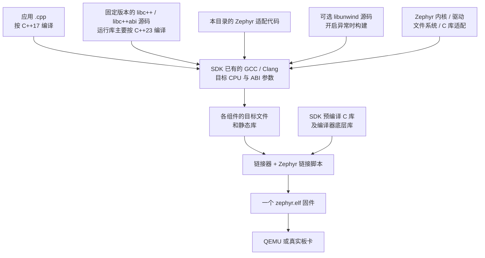
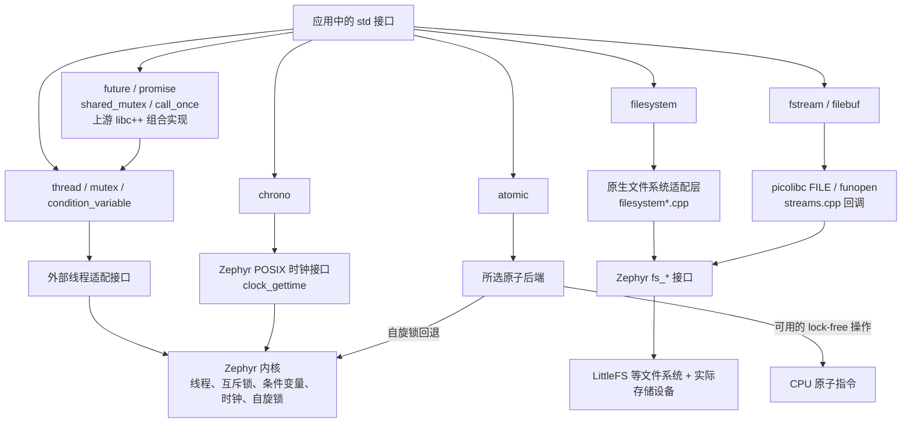
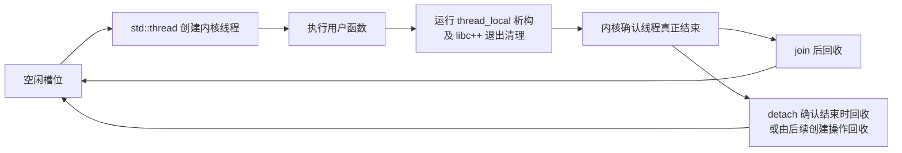
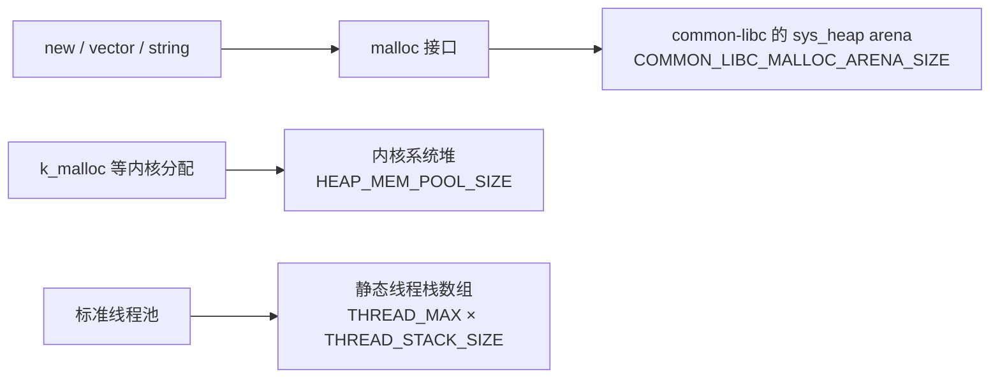
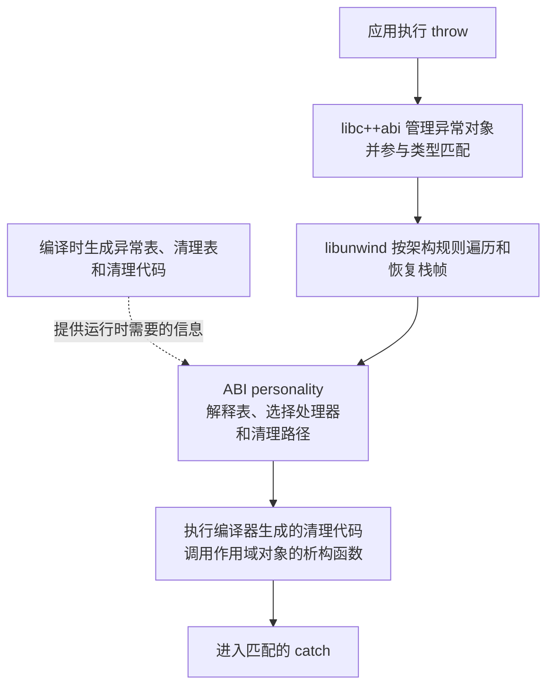

<!--
SPDX-FileCopyrightText: Copyright The Zephyr Project Contributors
SPDX-License-Identifier: Apache-2.0
-->

# Zephyr 上的 C++17：中文原理与实验指南

这份指南介绍本目录的 libc++ PoC：它为什么需要适配、各层怎样配合，以及如何自己写程序验证。
[英文参考](README.rst)保留配置和接口边界的简要说明；这里从基础概念开始讲。

建议阅读顺序：先看第 1～4 节理解架构，再按第 6～8 节运行实验，遇到问题查第 10 节。
所有实验命令都在 **WSL 的 Bash 终端**执行。建议在 GitHub 打开本文件查看 Mermaid 图，
每张图附近也有文字或调用表说明。

## 1. Zephyr 本来就能运行 C++，这次到底补了什么？

先把“运行 C++”拆成三件事：

1. **编译语言**：把类、模板、重载、lambda 等语法翻译成目标 CPU 的指令。
2. **提供库**：让 `std::vector`、`std::thread`、`std::filesystem` 等接口有可用的实现。
3. **接入系统**：把库需要的线程、等待、时钟、文件等服务接到 Zephyr。

例如，一个只有普通类、模板和栈对象的程序，主要依靠编译器生成代码。
`std::vector` 还需要分配内存和部分运行时支持。
`std::thread` 则必须最终创建一个真实的操作系统线程。

所以，Zephyr 能编译 C++，并不代表所选 C++ 库的每个 OS 接口都已接好。
“缺少 `std::thread` 支持”通常意味着这条库到操作系统的路径不完整。

本 PoC 主要补第 2、3 件事：在 Zephyr 构建过程中，用现有编译器从源码构建 libc++，
并提供与 Zephyr 配合的后端。应用仍写普通的 C++17 代码。

RAII 可以先理解为“资源跟着对象的生命周期走”：对象离开作用域时，析构函数负责释放资源。
例如 lock_guard 析构时解锁，异常离开作用域时也需要执行这类清理。
单独设置 -std=c++17 只选择语言规则，并不会自动补齐操作系统后端。

## 2. 几个名字分别负责什么？

| 名字 | 可以怎样理解 | 在这里的职责 |
| --- | --- | --- |
| GCC / Clang | 把源代码变成机器码的工具 | 编译应用、运行库和适配层 |
| libstdc++ / libc++ | C++ 标准库的两种实现 | 本 PoC 选择 libc++，提供容器、线程、流等接口 |
| libc++abi | C++ 的底层运行规则实现 | 异常对象、类型匹配、RTTI、部分初始化和内存分配支持 |
| libunwind | 沿调用栈向上查找和恢复执行现场的库 | 与编译器生成的表、libc++abi 一起完成异常栈展开 |
| picolibc | 面向嵌入式的 C 库 | 提供 C 函数接口、真正的 `FILE` 结构及 stdio 等设施 |
| Zephyr 内核和子系统 | 真正管理硬件资源的系统 | 调度线程、锁、等待、时钟、文件系统、随机源 |
| SDK / toolchain | 上述编译工具及配套文件的集合 | 提供编译器、汇编器、链接器、C 库/底层编译器运行库等 |

GCC 和 libstdc++、Clang 和 libc++ 是常见组合，但不是强制绑定。
本实现让 **GCC 或 Clang 编译同一份 libc++ 源码**，然后链接进同一个 Zephyr 固件。

这里仍使用 SDK 提供的编译工具和需要的底层库。
替换的是默认的 **C++ 头文件和预编译 C++ 标准库的选择**，
不是把 SDK 的所有内容都排除掉。

ABI（应用二进制接口）是二进制代码相互配合的约定，包括参数怎样传递、
对象怎样排列、函数符号怎样命名、异常类型信息怎样解释。
函数名字相同还不够：两份库对同一个锁对象的大小和布局理解不同，也会出错。

## 3. 架构图：构建时和运行时分别发生什么？

### 3.1 构建时：最终生成一个固件



适配层在编译、链接时进入固件，运行时不会再去加载一个 Linux 动态库。

构建由应用的 `CMakeLists.txt`、`prj.conf`、Zephyr 的 Kconfig/CMake 共同驱动。
本目录的 [CMakeLists.txt](CMakeLists.txt)负责获取固定版本源码、生成库配置、
选择运行库源文件以及注册适配层。

SDK 本身不需要重新构建。构建目录中的配置、兼容头文件可以删除后重新生成，
安装目录中的编译器和 sysroot 不会被修改。

目标文件 .o/.obj 是编译出的机器码片段；静态库 .a 可以理解为目标文件的集合；
链接器把被使用的片段及必要的表组合成 ELF 固件。
#include 让编译器看到声明和模板实现，链接则要把需要的底层实现一起带进来。

**为什么应用 C++17，库却用 C++23？**

语言版本是按源文件设置的。这份 libc++ 19 源码内部需要较新的语言特性，
所以库源文件主要使用 C++23；应用的 `main.cpp` 仍按 `-std=c++17` 编译。
libunwind 和个别兼容文件有各自的编译选项。

这也解释了为什么本版本要求 GCC 14 或 Clang 17 以上：
这是所选运行库源码的构建要求，不是“写 C++17 必须用这么新的编译器”。

使用内部修改版工具链时，先按项目已有方式让 Zephyr 选中它，再运行这些实验。
源码构建减少了对 SDK 内预编译 C++ 库配置的依赖，但编译器版本、目标 CPU/ABI、
TLS、原子操作和异常表生成能力仍会影响结果。当前 SDK 的通过结果不能代替内部工具链验证。


### 3.2 运行时：不同接口有不同的后端



图里的“Zephyr POSIX 时钟接口”是一层系统接口兼容代码，不表示固件运行了 Linux。
本实现的线程没有绕到 pthread；时钟则复用了 Zephyr 已有的 POSIX 时钟接口。

几条具体路径：

| 应用调用 | 最终怎样落地 |
| --- | --- |
| `std::thread` | libc++ 封装可调用对象 → `__libcpp_thread_create` → 线程池 → `k_thread_create` |
| `std::mutex::lock` | libc++ → 外部线程接口 → 首次初始化保护 → `k_mutex_lock` |
| `condition_variable::wait` | libc++ → 外部线程接口 → `k_condvar_wait` |
| `steady_clock::now` | libc++ → `clock_gettime(CLOCK_MONOTONIC)` → 内核时间 |
| `system_clock::now` | libc++ → `CLOCK_REALTIME` → 系统实时时钟 |
| `this_thread::sleep_for` | 线程适配器 → 内核超时和 `k_sleep` |
| `filesystem::file_size` | 本地文件系统后端 → `fs_stat` |
| `ofstream` 写文件 | libc++ filebuf → 真实 `FILE` → 回调中的 `fs_write` |
| `random_device` | 本地实现 → `sys_csrand_get` |

不要把所有高级接口都看作“一对一包装一个内核 API”。
例如 future/promise 的结果和异常管理、shared_mutex 的组合逻辑，主要来自上游 libc++；
我们提供它们下面的线程和同步原语。

### 3.3 为什么不统一走 pthread？

另一条常见路线是：

```text
C++ 标准库 → pthread / POSIX 文件接口 → RTOS 的 POSIX 兼容层 → 内核
```

这条路线本身是合理的，但“RTOS 有 pthread 函数”还不够。
标准库编译时选了什么后端、头文件中的类型布局、链接库和运行时约定，也必须匹配。

这个 PoC 选择原生线程接口，原因是可以在应用构建时控制库与后端，
直接使用 Zephyr 的线程、栈和同步资源，也不必重建 SDK 中已经安装的 C++ 库。

代价是我们需要维护这层适配，特别是线程退出、TLS 析构、超时和异常安全的细节。
以后可以评估 POSIX 路线，但不能只把一个名字替换成 pthread 就认为接通了。

选择 libc++ 的一个实际考虑，是它的外部线程接口适合在这次源码构建中接入原生后端，
并且 GCC、Clang 可以共用同一份库源码和配置。这个 PoC 没有实现 libstdc++ 路线，
也没有证明 libc++ 对所有版本和板卡都更合适。

## 4. 实现考虑和难点在哪里？

### 4.1 创建线程只完成了一半，退出和资源回收同样重要

[threading.cpp](threading.cpp)预先保留线程对象和线程栈。
默认有 8 个槽位，每个线程栈请求 4096 字节。

TLS 是“线程局部存储”：thread_local 变量让每个线程拥有独立的一份数据。
它的生命周期可能持续到线程退出，因此除了普通函数返回时的栈对象，还要处理这类析构。



用户函数返回时，线程还可能正在自己的栈上做退出清理。
这时立即把栈交给另一个线程，会破坏仍在执行的线程。

因此：

- `join()` 会等待内核确认结束，再释放槽位。
- `detach()` 表示不再 join，不表示杀死线程。
- detach 时如果已经确认线程结束，可以回收槽位；否则由后续创建操作确认结束后回收。
- 语言级 `thread_local` 析构先于 libc++ 退出通知和相关 future 就绪。
- `k_thread_abort()` 会绕过正常清理路径，不属于这个适配器支持的退出方式。
- 普通 Zephyr 原生线程可以使用同步接口，但不会自动获得这套完整的退出清理。

### 4.2 mutex 和条件变量也有初始化及等待规则

C++ 锁对象需要配合 C++ 的初始化规则，内核锁又需要初始化。
私有线程类型中保存了内核锁和初始化标记，第一次使用时在保护下初始化，
避免两个 CPU 同时初始化同一个对象。

条件变量的等待过程是：

```text
持有 mutex → 检查共享状态
           → 未满足时，等待操作释放 mutex 并睡眠
           → 被唤醒后重新持有 mutex
           → 再检查共享状态
```

应用通常应写 `cv.wait(lock, predicate)`。通知表示“现在值得再检查条件”，
并不是把一个结果值直接传给等待者。

已有[线程示例](../../../samples/cpp/libcxx_threads/src/main.cpp)就是这种写法。
只读通知、不检查共享状态，或者持锁睡眠等别人修改同一状态，都容易写错。

### 4.3 C++ 堆、内核堆和线程栈是三种资源



本配置下，libc++abi 的 `operator new` 调用 `std::malloc`，
所选 common-libc 实现用自己的 `sys_heap` arena 管理内存。
因此 C++ `bad_alloc` 往往要检查 `CONFIG_COMMON_LIBC_MALLOC_ARENA_SIZE`。

`CONFIG_HEAP_MEM_POOL_SIZE` 控制另一块内核系统堆，增大它并不等于增大 C++ 对象堆。

线程栈也不是从 `new` 的对象堆里分配的。默认 8 × 4096 字节仅标称栈空间就有 32 KiB，
实际还包含架构对齐、TLS、保护等开销。主线程栈还由 `CONFIG_MAIN_STACK_SIZE` 单独控制。

### 4.4 原子操作的难点是“对象多大”和“是否有真正的原子指令”

32 位 CPU 处理 64 位数或 12 字节结构体时，不一定有直接可用的原子指令。
编译器可能生成对外部 `__atomic_*` helper 的调用，必须有配套实现。

[atomics.c](atomics.c)处理这层需要：

- 能保证 lock-free 的对齐操作，继续用编译器生成的原生原子操作。
- 其他操作共用一把跨 CPU 自旋锁，同时屏蔽本地中断。
- 只关闭当前 CPU 的中断，不能保护另一个 CPU 上的并发访问。
- 回退操作不是 lock-free，`is_lock_free() == false` 是正常结果。
- 大对象复制期间持锁并关中断，会增加中断延迟。

在 Clang 19 / RISC-V 组合上还发现了 C11 聚合原子处理问题：
12 字节对象会被补到 16 字节，失败 CAS 的 `expected` 回写也可能丢失。
这里选择 libc++ 已有的 GNU-intrinsic 原子后端，使库和应用使用一致的配置，
没有修改编译器。测试检查了对象大小、对齐、强弱 CAS 和并发更新。

当前要求编译器原生支持对齐的 1、2、4 字节 lock-free 原子操作；
Cortex-M0 等不满足条件的目标会明确报错。

### 4.5 异常处理是编译器、ABI 库、展开器共同完成的



这张图省略了搜索、清理等阶段之间的往返，但保留了各层职责：
libunwind 不会自己认识所有 C++ 对象，也不会独自决定该调用哪个析构函数。

personality 可以理解为 ABI 库提供给展开器的回调：根据当前函数的异常表，
告诉展开器哪些处理器或清理路径适用。

ARM 使用 EHABI，RISC-V 使用 DWARF。
ARM 的类型表要按裸机 ABI 解释，不能套 Linux 的 GOT 间接访问规则。
RISC-V 的链接器能提供索引时使用索引，否则扫描保留的 `.eh_frame`。

应用可以关闭 RTTI，单独开启异常；运行库内部仍保留异常匹配所需的类型信息。
这与应用是否可以使用 `dynamic_cast`、`typeid` 的选项分开处理。

**异常不会因为 join 自动传到创建线程。**
`std::thread` 的用户回调有未捕获异常时仍会 terminate。
跨线程传异常要用 promise/future，或者 `std::async(std::launch::async, ...)`，
在 `future.get()` 时重新抛出。第 7 节会实际演示。

### 4.6 为什么“异常能 catch”之后还要测试内存失败？

例如，先打开目录，再构造一个需要分配内存的字符串。
字符串分配失败时，如果没有正确保护，目录句柄会泄漏。

还要注意：对象构造过程中抛异常时，这个尚未构造完成的完整对象不会执行自己的析构函数。
已经打开的底层资源必须有单独的 guard 保护。

因此实现用了 RAII 锁和目录句柄保护，并通过分配失败注入测试检查清理。
对于要求不抛异常的元数据 `error_code` 接口，内部路径分配失败转换为 `ENOMEM`。
标准允许抛 `bad_alloc` 的其他接口仍可能抛异常。

### 4.7 文件路径、文件系统和文件内容是不同层

`std::filesystem::path` 的拼接、拆分、词法处理，很多只是字符串运算。
查文件大小、遍历真实目录、复制文件等操作，才需要底层文件系统。

读取和写入文件内容通常使用 `fstream` 或原生文件接口。
`std::filesystem` 不会自动完成板级存储驱动初始化、格式化和挂载。

当前文件流使用 picolibc 真正的 `FILE/funopen`，通过回调调用 `fs_read/write/seek/close`。
Zephyr POSIX fd 的包装结构与 picolibc `FILE` 布局不相同，不能直接强转。

为了让 flush 后的数据对其他句柄可见，桥接层在每次缓冲写回时执行 `fs_sync`。
这样实现明确，但会增加写入同步开销，后续需要按实际存储性能评估。

### 4.8 时间单位不等于计时精度

`steady_clock` 适合测耗时；`system_clock` 适合表示日历时间。
系统时间仍需由 RTC、网络校时或其他来源初始化。

`nanoseconds` 是数值单位，不保证内核能按 1 ns 唤醒线程。
真实精度受时钟、tick 配置和调度延迟影响。

当前绝对条件变量超时会转换为相对内核等待；
等待过程中调整 realtime，不会立即更新已经提交的等待超时。

## 5. 当前能用什么，边界在哪里？

| 功能 | 当前情况 | 应用需要注意 |
| --- | --- | --- |
| 类、模板、lambda、常规 RAII | 编译器提供语言支持 | 仍要按目标 CPU 编译 |
| 线程和同步 | 已有创建、join/detach、mutex、CV、共享锁等集成测试 | 线程池、栈和优先级受配置限制 |
| chrono 和 C 时间函数 | 已验证常用时钟、时间计算、睡眠与转换 | 日历时间要初始化；不提供时区数据库 |
| filesystem | 路径、目录、大小、空间、复制、删除等子集 | copy/equivalent 的身份检查目前限 LittleFS |
| 文件流、字符串流、regex | 可选的窄字符支持 | 当前与 FILESYSTEM、PICOLIBC_IO_FLOAT 配合启用 |
| 异常、RTTI | 可分别开启，已验证栈展开、析构和类型匹配 | 正常静态固件线程内使用 |
| random_device | 可选，接 Zephyr 安全随机源 | 不用普通 PRNG 或时钟作为兜底；entropy 返回未知值 0 |
| 容器、智能指针、optional/variant/any、PMR 等 | 有针对性集成测试 | 不代表跑过整个上游标准一致性测试 |
| 字符转换 | 整数 from_chars、浮点 to_chars 可用 | libc++ 19 缺浮点 from_chars；long double 格式化会窄化为 double |

还必须保留这些限制：

- 这个配置面向目标板构建，不支持 native_sim 这类 native build；本文使用 QEMU 目标板。
- 当前异常后端允许 ARM 和 RISC-V；其他架构需要另外接入和验证。
- 全局/static 对象的退出析构仍受 Zephyr 启停机制约束；main 返回不等于 Linux 进程退出。
- 当前只支持 supervisor 构建，拒绝 `CONFIG_USERSPACE=y`。
- 文件权限、时间戳、硬链接、符号链接等缺少完整后端；相应操作报告不支持。
- C++ 文件后端有自己的全局 current directory，不改变原生/POSIX API 的工作目录。
- 不支持跨 ISR、内核边界或缺少展开信息的 C 栈帧抛异常。
- 当前仅支持静态固件，不提供动态/JIT/LLEXT 代码的异常展开支持。
- 宽字符、完整 Unicode 转换、区域 locale 等不在当前配置范围；主要验证 classic C locale。
- 测试目标上的 streamoff 是 32 位，文件偏移还受具体文件系统限制。
- 默认关闭异常时，原本要 throw 的错误路径可能终止程序；error_code 也不保证所有内存分配失败都可恢复。
- 同一固件的 C++ 对象必须使用一致的库配置和 ABI，不能混入暴露不兼容 libstdc++/SDK libc++ 类型的对象。

当前验证基线是 SDK 1.0.1 中的 GCC 14.3.0、Clang 19.1.7，
覆盖 ARM Cortex-M3、RISC-V32 单核/双核 QEMU。
主矩阵 54 个配置，加 4 个独立开关配置，共 1,158 项用例通过。
内部修改版编译器和真实板卡还需要单独验证。

若要使用 random_device，还需启用 CONFIG_LIBCXX_RANDOM_DEVICE，
并配置平台可用的安全随机源以满足 CSPRNG 依赖。普通伪随机引擎可以独立使用。
测试中的确定性随机源用于检查调用和错误传递，不代表真实硬件熵质量。

## 6. 先运行已有示例，确认环境

本指南中的最小示例、线程/异常实验、文件系统实验，均已用 GCC 和 Clang
在 mps2/an385 上按文中命令运行验证，共六种组合。完整集成矩阵另见第 9 节。

### 6.1 进入 WSL 并设置环境

在 Windows 终端进入 WSL：

```powershell
wsl.exe -d Ubuntu-24.04
```

然后在 WSL Bash 中执行：

```bash
source /home/linux/zephyrproject/.venv/bin/activate
cd /home/linux/zephyrproject/zephyr-libcxx-poc

export ZEPHYR_BASE="$PWD"
export ZEPHYR_SDK_INSTALL_DIR=/home/linux/zephyr-sdk-1.0.1
export ZEPHYR_TOOLCHAIN_VARIANT=zephyr
export CMAKE_BUILD_PARALLEL_LEVEL=4

export LIBCXX_POC_DEPS=/home/linux/libcxx-poc-deps
export LIBCXX_POC_OUT=/home/linux/libcxx-poc-build/manual
mkdir -p "$LIBCXX_POC_OUT"

libcxx_source_args=(
  "-DLIBCXX_SOURCE_DIR=$LIBCXX_POC_DEPS/libcxx-19.1.7.src"
  "-DLIBCXXABI_SOURCE_DIR=$LIBCXX_POC_DEPS/libcxxabi-19.1.7.src"
)

west --version
git branch --show-current
df -h / /mnt/c
```

这是当前机器的实际路径，换机器时替换相应路径。
每次新开终端，要重新执行环境设置和数组定义。

显式设置 `ZEPHYR_BASE` 很重要：这个目录是 Git worktree，
west 工作区原本登记的 Zephyr 目录可能是另一份源码。

机器上可能有多个 SDK，不能只依赖自动搜索。
已有工作区不需要为了运行本例重新 west init 或修改共享模块。

### 6.2 构建并运行最小线程示例

先用 GCC：

```bash
west build -p always -b mps2/an385 \
  -d "$LIBCXX_POC_OUT/sample-gcc" \
  samples/cpp/libcxx_threads -- \
  -DTOOLCHAIN_VARIANT_COMPILER=gnu \
  "${libcxx_source_args[@]}"

west build -d "$LIBCXX_POC_OUT/sample-gcc" -t run
```

应该能看到：

```text
libc++ threads: 4000 increments
```

QEMU 可能在 main 返回后继续运行。可按 `Ctrl+A`，松开后再按 `X` 退出 QEMU。

再换 Clang，用单独的构建目录：

```bash
west build -p always -b mps2/an385 \
  -d "$LIBCXX_POC_OUT/sample-clang" \
  samples/cpp/libcxx_threads -- \
  -DTOOLCHAIN_VARIANT_COMPILER=llvm \
  "${libcxx_source_args[@]}"

west build -d "$LIBCXX_POC_OUT/sample-clang" -t run
```

`-p always` 表示清理并重新配置指定构建目录。
只把它用于这里专用的构建目录。GCC 和 Clang 各用一个目录，避免混用缓存。

### 6.3 源码从哪里来？

上面的两个路径指向已经解压的固定版本源码，便于离线构建。
不开异常的最小示例不需要 libunwind 源码参数。

不传这两个路径时，CMake 会下载固定版本归档并校验 SHA-256。
开启异常时还会获取匹配的 libunwind。
本地覆盖目录不经过下载哈希检查，使用者要保证来源和版本正确。

运行库、适配层与应用在一次 Zephyr 构建中生成；不需要先去重建整个 SDK。

## 7. 自己写实验一：线程、时间、64 位原子和异常

本节创建一个独立应用。它使用普通 C++ 接口，应用源文件中没有直接调用 Zephyr 内核 API。

### 7.1 创建目录

继续使用第 6 节的 Bash 环境：

```bash
export LIBCXX_LAB_APP=/home/linux/libcxx-poc-lab
mkdir -p "$LIBCXX_LAB_APP/src"
```

如果这个目录已有自己的项目，换一个新的目录。
随后用编辑器创建下列文件，复制各代码块内容。

目录结构最终是：

```text
libcxx-poc-lab/
├── CMakeLists.txt
├── prj.conf
└── src/
    └── main.cpp
```

### 7.2 CMakeLists.txt

```cmake
# SPDX-FileCopyrightText: Copyright The Zephyr Project Contributors
# SPDX-License-Identifier: Apache-2.0

cmake_minimum_required(VERSION 3.20.0)
find_package(Zephyr REQUIRED HINTS $ENV{ZEPHYR_BASE})
project(libcxx_lab LANGUAGES C CXX)

set(LIBCXX_LAB_SOURCE "src/main.cpp" CACHE STRING "Source used by the experiment")
target_sources(app PRIVATE "${LIBCXX_LAB_SOURCE}")
```

最后两行允许第 8 节选择另一个入口源文件。
平常项目也可以直接写 `target_sources(app PRIVATE src/main.cpp)`。

### 7.3 prj.conf

```cfg
# SPDX-FileCopyrightText: Copyright The Zephyr Project Contributors
# SPDX-License-Identifier: Apache-2.0

CONFIG_CPP=y
CONFIG_STD_CPP17=y
CONFIG_PICOLIBC=y
CONFIG_LIBCXX_SOURCE_LIBCPP=y
CONFIG_POSIX_SYSTEM_INTERFACES=y
CONFIG_POSIX_TIMERS=y
CONFIG_POSIX_MONOTONIC_CLOCK=y

CONFIG_CPP_EXCEPTIONS=y
CONFIG_CPP_RTTI=y

CONFIG_MAIN_STACK_SIZE=8192
CONFIG_LIBCXX_THREAD_STACK_SIZE=8192
CONFIG_COMMON_LIBC_MALLOC=y
CONFIG_COMMON_LIBC_MALLOC_ARENA_SIZE=65536
CONFIG_HEAP_MEM_POOL_SIZE=8192
```

几个关键点：

- `CONFIG_CPP` 打开语言支持，`CONFIG_STD_CPP17` 选择应用语言版本。
- `CONFIG_LIBCXX_SOURCE_LIBCPP` 选择本 PoC 的源码运行库。
- 三个 POSIX 配置为 chrono 所需的时钟接口提供依赖，不会因此开启 pthread 后端。
- 本实验开启异常和 RTTI，给主线程、标准线程和 C++ 对象堆留出空间。
- 若要完全关闭异常，需要删去/改写示例中的 throw/try/catch 逻辑，并修改配置。

### 7.4 src/main.cpp

```cpp
/*
 * SPDX-FileCopyrightText: Copyright The Zephyr Project Contributors
 * SPDX-License-Identifier: Apache-2.0
 */

#include <array>
#include <atomic>
#include <chrono>
#include <cstdint>
#include <cstdio>
#include <future>
#include <mutex>
#include <stdexcept>
#include <thread>

struct ScopeLog {
    ~ScopeLog()
    {
        std::puts("async scope cleaned");
    }
};

int main()
{
    using namespace std::chrono;
    const auto begin = steady_clock::now();
    std::mutex lock;
    unsigned int count = 0;
    std::atomic<std::uint64_t> atomic_count{0};
    std::array<std::thread, 2> workers;

    for (auto &worker : workers) {
        worker = std::thread([&] {
            for (unsigned int i = 0; i < 1000; ++i) {
                {
                    std::lock_guard<std::mutex> guard(lock);
                    ++count;
                }
                atomic_count.fetch_add(1, std::memory_order_relaxed);
            }
            std::this_thread::sleep_for(milliseconds(20));
        });
    }
    for (auto &worker : workers) {
        worker.join();
    }

    std::printf("count=%u atomic=%u lock_free=%d\n", count,
                static_cast<unsigned int>(atomic_count.load()),
                static_cast<int>(atomic_count.is_lock_free()));

    auto result = std::async(std::launch::async, []() -> int {
        ScopeLog cleanup;
        throw std::runtime_error("demo exception");
    });

    bool caught = false;
    try {
        (void)result.get();
    } catch (const std::exception &error) {
        caught = true;
        std::printf("caught via future: %s\n", error.what());
    }

    const auto elapsed = duration_cast<milliseconds>(steady_clock::now() - begin);
    std::printf("elapsed_ms=%d\n", static_cast<int>(elapsed.count()));
    const bool ok = count == 2000 && atomic_count.load() == 2000 && caught;
    std::puts(ok ? "libcxx lab: PASS" : "libcxx lab: FAIL");
    return ok ? 0 : 1;
}
```

运行时要观察三件事：

1. 两个线程完成后，两个计数都为 2000。
2. `async scope cleaned` 出现在 `caught via future` 之前，说明异常展开执行了析构。
3. 最后打印 `libcxx lab: PASS`。

Cortex-M3 上 64 位原子可能显示 `lock_free=0`，这并不表示结果不可靠，
而是由适配器用锁保证原子性。这里的 relaxed 只用于独立计数；
需要线程间发布其他数据时，应理解并选择相应内存顺序。

### 7.5 编译运行自己的程序

GCC：

```bash
west build -p always -b mps2/an385 \
  -d "$LIBCXX_POC_OUT/lab-gcc" \
  "$LIBCXX_LAB_APP" -- \
  -DTOOLCHAIN_VARIANT_COMPILER=gnu \
  "${libcxx_source_args[@]}" \
  "-DLIBUNWIND_SOURCE_DIR=$LIBCXX_POC_DEPS/libunwind-19.1.7.src"

west build -d "$LIBCXX_POC_OUT/lab-gcc" -t run
```

Clang：

```bash
west build -p always -b mps2/an385 \
  -d "$LIBCXX_POC_OUT/lab-clang" \
  "$LIBCXX_LAB_APP" -- \
  -DTOOLCHAIN_VARIANT_COMPILER=llvm \
  "${libcxx_source_args[@]}" \
  "-DLIBUNWIND_SOURCE_DIR=$LIBCXX_POC_DEPS/libunwind-19.1.7.src"

west build -d "$LIBCXX_POC_OUT/lab-clang" -t run
```

换成 RISC-V 时，使用相应板名及新的构建目录：

- 单核：`qemu_riscv32/qemu_virt_riscv32`
- 双核：`qemu_riscv32/qemu_virt_riscv32/smp`

改了程序以后，可以对原目录执行 `west build -d <目录>` 后再运行。
更换编译器、板卡或关键配置时，用独立目录或 `-p always` 重新配置更容易排查问题。

## 8. 自己写实验二：RAM 盘、filesystem 和文件流

这个实验会增加少量 Zephyr 原生初始化代码，然后使用 C++ 接口操作文件。
板级存储的准备仍由应用负责；挂载后，业务层可以使用标准 C++ 路径和流。

### 8.1 filesystem.conf

在实验目录创建额外配置文件：

```cfg
# SPDX-FileCopyrightText: Copyright The Zephyr Project Contributors
# SPDX-License-Identifier: Apache-2.0

CONFIG_LIBCXX_FILESYSTEM=y
CONFIG_LIBCXX_STREAMS=y
CONFIG_PICOLIBC_IO_FLOAT=y
CONFIG_LIBCXX_FILESYSTEM_TEMP_DIR="/lfs"
CONFIG_COMMON_LIBC_MALLOC_ARENA_SIZE=98304

CONFIG_FILE_SYSTEM=y
CONFIG_FILE_SYSTEM_MKFS=y
CONFIG_FILE_SYSTEM_LITTLEFS=y
CONFIG_FS_LITTLEFS_BLK_DEV=y
CONFIG_FS_LITTLEFS_FMP_DEV=n
CONFIG_FS_LITTLEFS_CACHE_SIZE=512
CONFIG_FS_LITTLEFS_NUM_FILES=8
CONFIG_FS_LITTLEFS_NUM_DIRS=8
CONFIG_DISK_ACCESS=y
CONFIG_DISK_DRIVERS=y
CONFIG_DISK_DRIVER_RAM=y
```

它与 `prj.conf` 合并。这个 profile 的 streams 依赖文件后端及 picolibc 浮点 I/O，
因此即使实验只写字符串，也需要满足这些配置依赖。

### 8.2 filesystem.overlay

直接复制已经使用过的 RAM 盘设备树示例：

```bash
cp "$ZEPHYR_BASE/tests/lib/cpp/libcxx_streams/app.overlay" \
  "$LIBCXX_LAB_APP/filesystem.overlay"
```

它创建一个名为 `LIBCXX` 的 RAM 盘，大小为 256 × 512 字节，即 128 KiB。
这里的 `/lfs` 是固件内部挂载点，和 WSL/Windows 的目录没有对应关系。

### 8.3 src/filesystem.cpp

```cpp
/*
 * SPDX-FileCopyrightText: Copyright The Zephyr Project Contributors
 * SPDX-License-Identifier: Apache-2.0
 */

#include <cstdint>
#include <cstdio>
#include <filesystem>
#include <fstream>
#include <stdexcept>
#include <string>
#include <system_error>

#include <zephyr/fs/fs.h>
#include <zephyr/fs/littlefs.h>

namespace fs = std::filesystem;

namespace {
const char disk_name[] = "LIBCXX";
struct fs_littlefs storage;
struct fs_mount_t mount;
std::uint8_t read_cache[512];
std::uint8_t prog_cache[512];
std::uint32_t lookahead[8];

int mount_ram_disk()
{
    storage.cfg.read_buffer = read_cache;
    storage.cfg.prog_buffer = prog_cache;
    storage.cfg.lookahead_buffer = lookahead;
    storage.cfg.read_size = sizeof(read_cache);
    storage.cfg.prog_size = sizeof(prog_cache);
    storage.cfg.cache_size = sizeof(read_cache);
    storage.cfg.lookahead_size = sizeof(lookahead);

    mount.type = FS_LITTLEFS;
    mount.fs_data = &storage;
    mount.storage_dev = const_cast<char *>(disk_name);
    mount.mnt_point = "/lfs";
    mount.flags = FS_MOUNT_FLAG_USE_DISK_ACCESS | FS_MOUNT_FLAG_NO_FORMAT;

    int ret = fs_mkfs(FS_LITTLEFS, reinterpret_cast<std::uintptr_t>(disk_name),
                     nullptr, FS_MOUNT_FLAG_USE_DISK_ACCESS);
    return ret == 0 ? fs_mount(&mount) : ret;
}
}

int main()
{
    const int mount_result = mount_ram_disk();
    if (mount_result != 0) {
        std::printf("mount failed: %d\n", mount_result);
        return 1;
    }

    bool ok = false;
    try {
        const fs::path directory = "/lfs/demo";
        const fs::path file = directory / "message.txt";
        fs::create_directories(directory);

        {
            std::ofstream output;
            output.exceptions(std::ios::failbit | std::ios::badbit);
            output.open(file, std::ios::trunc);
            output << "hello from C++17\n";
            output.close();
        }

        std::ifstream input;
        input.exceptions(std::ios::failbit | std::ios::badbit);
        input.open(file);
        std::string line;
        std::getline(input, line);
        input.close();
        std::printf("read: %s\n", line.c_str());

        std::error_code error;
        const auto bytes = fs::file_size(file, error);
        if (error) {
            throw fs::filesystem_error("file_size", file, error);
        }
        std::printf("file bytes: %u\n", static_cast<unsigned int>(bytes));

        for (const auto &entry : fs::directory_iterator(directory)) {
            std::printf("entry: %s\n", entry.path().c_str());
        }
        ok = line == "hello from C++17";
    } catch (const std::exception &error) {
        std::printf("filesystem error: %s\n", error.what());
    }

    const int close_result = fs_unmount(&mount);
    ok = ok && close_result == 0;
    std::puts(ok ? "libcxx filesystem lab: PASS" : "libcxx filesystem lab: FAIL");
    return ok ? 0 : 1;
}
```

这些挂载结构和缓存放在静态存储区，整个使用期间都有效。
流对象先关闭、目录迭代器先销毁，再卸载文件系统。

这个例子每次启动都格式化**临时 RAM 盘**，因此重启数据会消失。
真实闪存卷的启动流程通常挂载已有文件系统，格式化应由产品的数据管理策略决定。

### 8.4 构建文件实验

当前工作区的共享 LittleFS 版本可能较旧。
用隔离模块覆盖，匹配此 Zephyr 的 `west.yml`，不用改共享模块：

```bash
git -C "$LIBCXX_POC_DEPS/littlefs-manifest" rev-parse HEAD
```

当前匹配版本为 `e9a8638fc228e43a3156ed3ac602229af3e3c1d5`。

GCC：

```bash
west build -p always -b mps2/an385 \
  -d "$LIBCXX_POC_OUT/filesystem-gcc" \
  "$LIBCXX_LAB_APP" -- \
  -DTOOLCHAIN_VARIANT_COMPILER=gnu \
  "${libcxx_source_args[@]}" \
  "-DLIBUNWIND_SOURCE_DIR=$LIBCXX_POC_DEPS/libunwind-19.1.7.src" \
  "-DEXTRA_ZEPHYR_MODULES=$LIBCXX_POC_DEPS/littlefs-manifest" \
  -DEXTRA_CONF_FILE=filesystem.conf \
  -DDTC_OVERLAY_FILE=filesystem.overlay \
  -DLIBCXX_LAB_SOURCE=src/filesystem.cpp

west build -d "$LIBCXX_POC_OUT/filesystem-gcc" -t run
```

Clang 使用另一个输出目录并改编译器选择：

```bash
west build -p always -b mps2/an385 \
  -d "$LIBCXX_POC_OUT/filesystem-clang" \
  "$LIBCXX_LAB_APP" -- \
  -DTOOLCHAIN_VARIANT_COMPILER=llvm \
  "${libcxx_source_args[@]}" \
  "-DLIBUNWIND_SOURCE_DIR=$LIBCXX_POC_DEPS/libunwind-19.1.7.src" \
  "-DEXTRA_ZEPHYR_MODULES=$LIBCXX_POC_DEPS/littlefs-manifest" \
  -DEXTRA_CONF_FILE=filesystem.conf \
  -DDTC_OVERLAY_FILE=filesystem.overlay \
  -DLIBCXX_LAB_SOURCE=src/filesystem.cpp

west build -d "$LIBCXX_POC_OUT/filesystem-clang" -t run
```

预期输出包含：

```text
read: hello from C++17
file bytes: 17
entry: /lfs/demo/message.txt
libcxx filesystem lab: PASS
```

第一次可以先修改写入字符串、文件名、目录名，观察大小和遍历结果。
再尝试读取一个不存在的文件，分别观察 error_code 和异常形式的错误处理。

## 9. 怎样运行已有自动化测试？

`west build -t run` 适合交互观察；Twister 负责构建、运行、判定结果和生成报告。

先跑单个线程套件：

```bash
ZEPHYR_TOOLCHAIN_VARIANT=zephyr/gnu west twister \
  -p mps2/an385 \
  -T tests/lib/cpp/libcxx_threads \
  -O "$LIBCXX_POC_OUT/twister-threads-gcc" \
  -j2 -i --runtime-artifact-cleanup=pass \
  -x TOOLCHAIN_VARIANT_COMPILER=gnu \
  -x LIBCXX_SOURCE_DIR="$LIBCXX_POC_DEPS/libcxx-19.1.7.src" \
  -x LIBCXXABI_SOURCE_DIR="$LIBCXX_POC_DEPS/libcxxabi-19.1.7.src"
```

这里 `-i` 表示打印失败日志，`-j2` 控制 Twister 作业数。
`CMAKE_BUILD_PARALLEL_LEVEL=4` 另外约束 CMake 构建的并行度。
通过后自动清理产物可以节省磁盘；之后若要手工运行同一固件，需要重新构建。

Twister 的编译器发现和实际 CMake 选择都要一致：
Clang 测试同时使用 `ZEPHYR_TOOLCHAIN_VARIANT=zephyr/llvm` 和
`-x TOOLCHAIN_VARIANT_COMPILER=llvm`。

要完整复现主矩阵，可以执行：

```bash
for compiler in gnu llvm; do
  ZEPHYR_TOOLCHAIN_VARIANT=zephyr/$compiler west twister \
    -p mps2/an385 \
    -p qemu_riscv32/qemu_virt_riscv32 \
    -p qemu_riscv32/qemu_virt_riscv32/smp \
    -T tests/lib/cpp/libcxx_threads \
    -T tests/lib/cpp/libcxx_time \
    -T tests/lib/cpp/libcxx_filesystem \
    -T tests/lib/cpp/libcxx_standard \
    -T tests/lib/cpp/libcxx_exceptions \
    -T tests/lib/cpp/libcxx_streams \
    -T tests/lib/cpp/libcxx_random \
    -T tests/lib/cpp/libcxx_filesystem_alloc \
    -O "$LIBCXX_POC_OUT/twister-all-$compiler" \
    -j2 -i --runtime-artifact-cleanup=pass \
    -x TOOLCHAIN_VARIANT_COMPILER=$compiler \
    -x LIBCXX_SOURCE_DIR="$LIBCXX_POC_DEPS/libcxx-19.1.7.src" \
    -x LIBCXXABI_SOURCE_DIR="$LIBCXX_POC_DEPS/libcxxabi-19.1.7.src" \
    -x LIBUNWIND_SOURCE_DIR="$LIBCXX_POC_DEPS/libunwind-19.1.7.src" \
    -x EXTRA_ZEPHYR_MODULES="$LIBCXX_POC_DEPS/littlefs-manifest"
done
```

8 个测试目录会选择 9 个场景，因为 streams 同时登记了普通和开启异常的场景。

独立开关可以只对 standard 套件运行：

```bash
for compiler in gnu llvm; do
  for mode in exceptions rtti; do
    ZEPHYR_TOOLCHAIN_VARIANT=zephyr/$compiler west twister \
      -p mps2/an385 \
      -T tests/lib/cpp/libcxx_standard \
      -O "$LIBCXX_POC_OUT/twister-$compiler-$mode" \
      -j2 -i --runtime-artifact-cleanup=pass \
      -x TOOLCHAIN_VARIANT_COMPILER=$compiler \
      -x EXTRA_CONF_FILE=$mode.conf \
      -x LIBCXX_SOURCE_DIR="$LIBCXX_POC_DEPS/libcxx-19.1.7.src" \
      -x LIBCXXABI_SOURCE_DIR="$LIBCXX_POC_DEPS/libcxxabi-19.1.7.src" \
      -x LIBUNWIND_SOURCE_DIR="$LIBCXX_POC_DEPS/libunwind-19.1.7.src"
  done
done
```

`exceptions.conf` 是应用只开异常、RTTI 关闭；`rtti.conf` 反过来。
不要把这两个额外配置全局施加给所有测试目录。

主矩阵每个编译器/目标共 181 项用例，6 组组合共 1086 项；
独立开关 4 个配置另有 72 项，合计 1158 项。它们是集成验证，不是完整的 C++17 一致性认证。

## 10. 常见问题和定位顺序

| 现象 | 先检查什么 |
| --- | --- |
| Kconfig 选不中 LIBCXX_SOURCE_LIBCPP | Picolibc、C++17、TLS、POSIX 时钟依赖是否满足；是否误选原始 worktree |
| 只改了编译器选项却仍用旧编译器 | SDK 环境和 CMake 缓存；换独立目录重新配置 |
| new 抛 bad_alloc | C++ 对象堆 arena、分配峰值，不只看内核 heap |
| 创建线程失败 | 线程槽位是否耗尽，已创建的线程是否正常 join/detach，栈配置是否合适 |
| std::cout / stringstream 不能用 | 是否开启 streams，以及它依赖的 filesystem、浮点 I/O 配置 |
| 文件不存在或打不开 | 是否已经挂载、路径是否为固件内部路径、是否检查了错误码 |
| 文件权限/时间戳操作失败 | 当前原生 API 没有需要的元数据，可能就是 ENOTSUP |
| __ASSERT_ON 等模块接口报错 | LittleFS 是否匹配当前 west.yml；可以使用隔离模块覆盖 |
| __atomic_* 链接或 ABI 问题 | 应用和运行库是否都选择本 PoC，是否混入其他预编译 C++ 对象 |
| 改源码后仍出现旧行为 | 停止构建后修改，再用专用目录 -p always 重建，避免旧对象 |
| WSL 文件系统很大但构建仍报 I/O/只读 | 同时检查承载 VHD 的 Windows 磁盘，不能只看 WSL 根目录 |

QEMU 中主函数返回，不一定退出整个系统；它和在 Linux 终端运行一个普通进程不同。
如果暂时分不清错误，先运行第 6 节原有示例，再运行自己的程序，最后加文件系统配置。

## 11. 想改适配层，先看哪些文件？

| 文件 | 建议关注的内容 |
| --- | --- |
| [Kconfig](Kconfig) | 可选功能与线程资源限制 |
| [CMakeLists.txt](CMakeLists.txt) | 源码版本、头文件选择、编译选项、运行库源文件 |
| [include/__external_threading](include/__external_threading) | libc++ 与 Zephyr 之间的私有线程类型和函数声明 |
| [threading.cpp](threading.cpp) | 线程池、锁、等待、TLS 和退出处理 |
| [atomics.c](atomics.c) | 编译器需要的外部原子 helper |
| [filesystem.cpp](filesystem.cpp) | 路径解析、元数据、current directory 等原生操作 |
| [filesystem_copy.cpp](filesystem_copy.cpp) | 文件身份、复制及递归操作 |
| [filesystem_directory.cpp](filesystem_directory.cpp) | 目录句柄适配 |
| [streams.cpp](streams.cpp) | FILE 回调和原生文件读写 |
| [unwind.cmake](unwind.cmake) | libunwind 获取、编译和架构相关配置 |
| [headers.cmake](headers.cmake)、[gcc_headers.cmake](gcc_headers.cmake) | 构建目录中的版本相关头文件兼容处理 |
| [测试目录](../../../tests/lib/cpp) | 配置组合、实际使用方式、错误路径与并发验证 |

兼容处理保留上游实现和许可证，应用与运行库共用生成的配置及头文件。
例如 GCC 14 的特定模板误报只在少数生成函数范围内处理；
字符串析构兼容实例放在独立源文件中。
升级运行库或编译器时，应重新评估这些版本相关处理，不能机械沿用。

实际迁移应用时，可以按“纯计算和容器 → 线程同步 → 时间 → 文件 → 异常及错误路径”
逐步增加依赖。这样每一步都能知道是业务代码、库配置还是系统后端出了问题。
